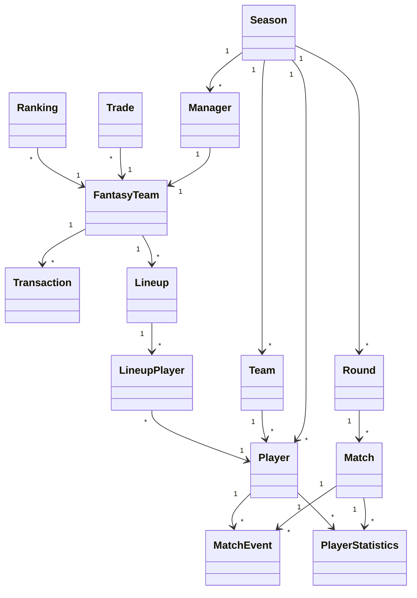

# Domain Model

## Purpose

This document describes the core business entities, their responsibilities and relationships within the Fantasy Tournament Platform.

The model is divided into three domains:

- Tournament Domain
- Fantasy Domain
- Administration Domain

---

# Tournament Domain

## Season

Represents a tournament edition for a specific year.

### Attributes

- id
- name
- year
- startersCount
- benchCount
- transferWindowOpen
- status

---

## Team

A real football team participating in the tournament.

### Attributes

- id
- name
- logo

---

## Player

A real football player participating in a season.

### Attributes

- id
- firstName
- lastName
- age
- photo

---

## Round

Represents a matchday of the tournament.

### Attributes

- id
- name
- roundNumber
- startDate
- endDate
- status

---

## Match

Represents a football match between two teams.

### Attributes

- id
- homeScore
- awayScore
- status
- finalized

---

## MatchEvent

Represents a recorded event during a match.

### Attributes

- id
- eventType
- createdAt

### Supported Events

- Goal
- Assist
- Save
- Yellow Card
- Red Card
- Own Goal

---

## PlayerStatistics

Stores the aggregated statistics of a player for a specific match.

### Attributes

- goals
- assists
- saves
- yellowCards
- redCards
- ownGoals
- fantasyPoints

---

# Fantasy Domain

## Manager

Represents a fantasy participant.

### Attributes

- id
- firstName
- lastName
- email
- password

---

## FantasyTeam

Represents the team owned by a manager.

### Attributes

- id
- name
- logo

---

## Lineup

Represents the active lineup for a specific round.

### Attributes

- id
- locked
- submittedAt

---

## LineupPlayer

Represents a player selected in a lineup.

### Attributes

- role

### Supported Roles

- STARTER
- BENCH
- CAPTAIN

---

## Trade

Represents a trade proposal between managers.

### Attributes

- id
- status
- proposedAt

### Supported Statuses

- PENDING
- ACCEPTED
- REJECTED
- CANCELLED

---

## Transaction

Represents roster movement history.

### Supported Types

- DRAFT_ASSIGNMENT
- PICKUP
- DROP
- TRADE

---

## Ranking

Represents fantasy standings.

### Attributes

- totalPoints
- roundPoints
- position

---

# Administration Domain

## Administrator

System administrator that manages tournaments, players and managers.

---

## Scorekeeper

User responsible for recording match events and finalizing matches.

---

# Domain Relationships

---

# Business Rules

- Each season contains exactly one fantasy league.
- Each manager owns exactly one fantasy team per season.
- A player may belong to only one fantasy team at a time.
- A lineup is created per round.
- Lineups become locked when the round starts.
- Transfers close when a round starts.
- A trade requires acceptance by another manager.
- Fantasy points are generated from match events.
- Match events can be corrected by administrators.
- Rankings are updated after match finalization.
