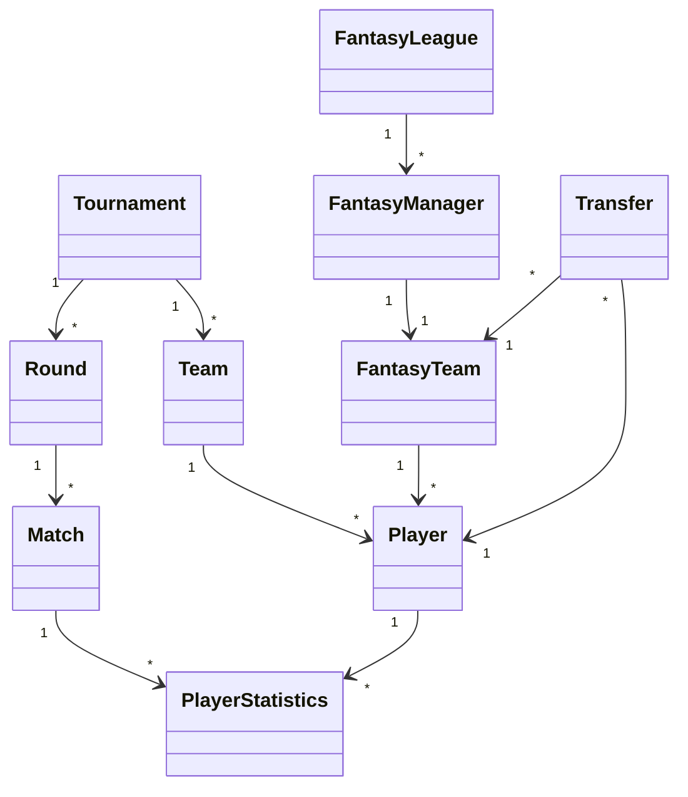

# Domain Model

## Overview

The Fantasy Tournament Platform combines amateur football tournament management with a draft-based fantasy competition system.

The platform consists of two connected domains:

1. Tournament Management Domain
2. Fantasy League Domain

Fantasy performance is directly derived from real match statistics recorded during the tournament.

---

## Tournament Management Domain

### Tournament

The overall competition that contains teams, rounds and matches.

### Team

A real football team participating in the tournament.

### Player

A real football player belonging to a specific team.

### Round

A stage or matchday of the tournament.

### Match

A scheduled game between two teams.

### Player Statistics

The recorded performance of a player during a match.

Examples:

- Goals
- Assists
- Clean Sheets
- Yellow Cards
- Red Cards

---

## Fantasy League Domain

### Fantasy League

The fantasy competition that contains all fantasy managers.

### Fantasy Manager

A registered user participating in the fantasy competition.

### Fantasy Team

The squad owned by a fantasy manager.

### Draft

The process through which players are selected before the competition begins.

### Transfer

A player exchange performed after the draft.

### Captain Selection

The process of selecting a captain whose score multiplier affects fantasy points.

### Fantasy Points

Points generated from real player statistics.

---

## Domain Diagram

---

## Business Rules

### BR-01

A player belongs to exactly one real team.

### BR-02

A match is played between exactly two teams.

### BR-03

Player statistics are recorded only after a match has been completed.

### BR-04

Each fantasy manager owns exactly one fantasy team.

### BR-05

A fantasy team contains multiple players.

### BR-06

A real player may belong to only one fantasy team at a time.

### BR-07

A player selected during the draft becomes unavailable to other fantasy managers.

### BR-08

Fantasy points are calculated from real player statistics.

### BR-09

Transfers can only occur according to league rules.

### BR-10

Every fantasy team must designate exactly one captain before a matchday.

