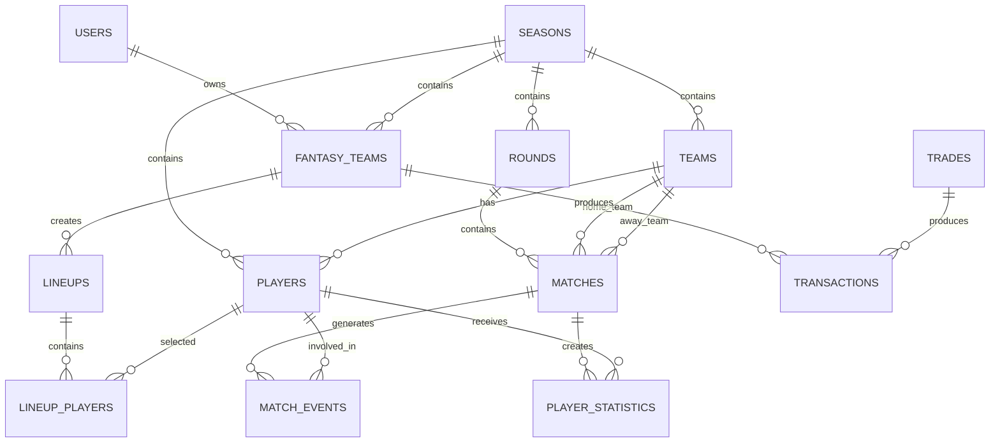

# Entity Relationship Diagram (ERD)

## Purpose

This document describes the database design of the Fantasy Tournament Platform.

The database is organized into three major domains:

- Tournament Management
- Fantasy League
- User Management

The design supports season-based tournaments, fantasy gameplay, historical data tracking and statistics generation.

---

# High-Level ER Diagram

---

# User Management Entities

## USERS

| Column | Description |
|----------|----------|
| id | Primary Key |
| first_name | User first name |
| last_name | User last name |
| email | Login email |
| password | Encrypted password |
| role | ADMIN, MANAGER, SCOREKEEPER |
| created_at | Creation timestamp |

---

# Tournament Entities

## SEASONS

| Column | Description |
|----------|----------|
| id | Primary Key |
| name | Season name |
| year | Tournament year |
| starters_count | Number of starters |
| bench_count | Number of substitutes |
| transfer_window_open | Transfer status |
| status | ACTIVE / COMPLETED |
|

## TEAMS

| Column | Description |
|----------|----------|
| id | Primary Key |
| season_id | FK -> seasons |
| name | Team name |
| logo | Team logo |

---

## PLAYERS

| Column | Description |
|----------|----------|
| id | Primary Key |
| season_id | FK -> seasons |
| team_id | FK -> teams |
| first_name | First name |
| last_name | Last name |
| age | Player age |
| photo | Player photo |

---

## ROUNDS

| Column | Description |
|----------|----------|
| id | Primary Key |
| season_id | FK -> seasons |
| round_number | Matchday number |
| start_date | Start date |
| end_date | End date |
| status | OPEN / LOCKED |

---

## MATCHES

| Column | Description |
|----------|----------|
| id | Primary Key |
| round_id | FK -> rounds |
| home_team_id | FK -> teams |
| away_team_id | FK -> teams |
| home_score | Final score |
| away_score | Final score |
| finalized | Boolean |
| status | SCHEDULED / IN_PROGRESS / FINALIZED |

---

## MATCH_EVENTS

| Column | Description |
|----------|----------|
| id | Primary Key |
| match_id | FK -> matches |
| player_id | FK -> players |
| event_type | GOAL / ASSIST / SAVE / YELLOW_CARD / RED_CARD / OWN_GOAL |
| created_at | Event timestamp |

---

## PLAYER_STATISTICS

| Column | Description |
|----------|----------|
| id | Primary Key |
| player_id | FK -> players |
| match_id | FK -> matches |
| goals | Aggregated value |
| assists | Aggregated value |
| saves | Aggregated value |
| yellow_cards | Aggregated value |
| red_cards | Aggregated value |
| own_goals | Aggregated value |
| fantasy_points | Generated fantasy points |

---

# Fantasy Entities

## FANTASY_TEAMS

| Column | Description |
|----------|----------|
| id | Primary Key |
| season_id | FK -> seasons |
| manager_id | FK -> users |
| name | Team name |
| logo | Team logo |
| total_points | Current fantasy points |

---

## FANTASY_TEAM_PLAYERS

Tracks the current roster ownership of players.

| Column | Description |
|----------|----------|
| id | Primary Key |
| fantasy_team_id | FK -> fantasy_teams |
| player_id | FK -> players |
| joined_at | Timestamp |
| left_at | Nullable Timestamp |

### Constraint

A player may belong to only one fantasy team at a time within a season.

---

## LINEUPS

| Column | Description |
|----------|----------|
| id | Primary Key |
| fantasy_team_id | FK -> fantasy_teams |
| round_id | FK -> rounds |
| locked | Boolean |
| submitted_at | Timestamp |

---

## LINEUP_PLAYERS

| Column | Description |
|----------|----------|
| id | Primary Key |
| lineup_id | FK -> lineups |
| player_id | FK -> players |
| role | STARTER / BENCH |
| is_captain | Boolean |

---

## TRADES

| Column | Description |
|----------|----------|
| id | Primary Key |
| proposing_team_id | FK -> fantasy_teams |
| receiving_team_id | FK -> fantasy_teams |
| offered_player_id | FK -> players |
| requested_player_id | FK -> players |
| status | PENDING / ACCEPTED / REJECTED / CANCELLED |
| proposed_at | Timestamp |

---

## TRANSACTIONS

| Column | Description |
|----------|----------|
| id | Primary Key |
| fantasy_team_id | FK -> fantasy_teams |
| player_id | FK -> players |
| trade_id | Nullable FK -> trades |
| transaction_type | DRAFT_ASSIGNMENT / PICKUP / DROP / TRADE |
| created_at | Timestamp |

---

# Business Constraints

## BC-01

Each player may belong to only one fantasy team at a time.

## BC-02

Each manager owns exactly one fantasy team per season.

## BC-03

Lineups are locked when the round starts.

## BC-04

Transfers are allowed only when the transfer window is open.

## BC-05

Match events cannot be modified after match finalization unless corrected by an administrator.

## BC-06

Fantasy points are generated automatically from player statistics.

## BC-07

A trade requires acceptance from the receiving manager.

## BC-08

Every transaction must be stored permanently for historical tracking.

---

# ERD Review Decisions

- Added FantasyTeamPlayer entity to represent current roster ownership.
- Transactions preserve history while FantasyTeamPlayer stores current state.
- LineupPlayer uses role (STARTER/BENCH) and is_captain flag.
- PlayerStatistics must be unique per player and match.
- Transactions should support from_team and to_team relationships during implementation.
