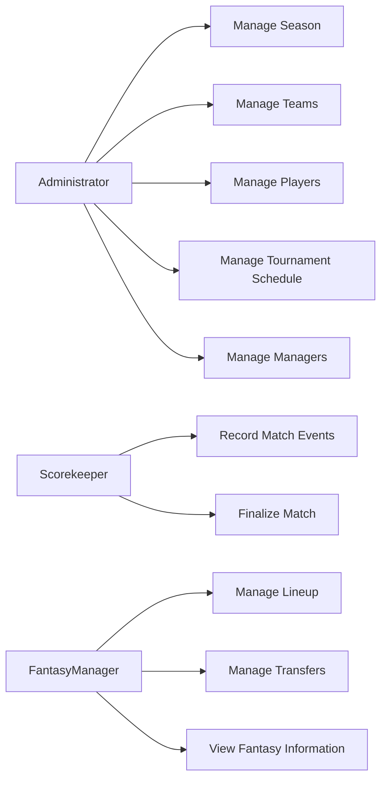

# Use Cases

## Purpose

This document describes the functional requirements of the Fantasy Tournament Platform through use cases.

The use cases define how the system interacts with its actors and how business processes are executed.

---

# Actors

## Administrator

Responsible for configuring and maintaining the tournament environment.

## Fantasy Manager

Responsible for managing a fantasy team.

## Scorekeeper

Responsible for recording match events and finalizing matches.

---

# Use Case Diagram

---

# Use Case Summary

| ID | Use Case | Primary Actor |
|----|-----------|---------------|
| UC-01 | Manage Season | Administrator |
| UC-02 | Manage Teams | Administrator |
| UC-03 | Manage Players | Administrator |
| UC-04 | Manage Tournament Schedule | Administrator |
| UC-05 | Manage Managers | Administrator |
| UC-06 | Record Match Events | Scorekeeper |
| UC-07 | Finalize Match | Scorekeeper |
| UC-08 | Manage Lineup | Fantasy Manager |
| UC-09 | Manage Transfers | Fantasy Manager |
| UC-10 | View Fantasy Information | Fantasy Manager |

---

# UC-01 Manage Season

## Goal

Create and manage tournament seasons.

## Main Flow

1. Administrator opens Season Management.
2. Administrator creates or edits a season.
3. Administrator configures season settings.
4. System saves the season.

## Alternative Flows

- Close Season.
- Reopen Season.

---

# UC-02 Manage Teams

## Goal

Create and maintain tournament teams.

## Main Flow

1. Administrator opens Team Management.
2. Administrator creates or edits a team.
3. Administrator uploads team logo.
4. System saves changes.

---

# UC-03 Manage Players

## Goal

Create and maintain player information.

## Main Flow

1. Administrator creates player.
2. Administrator enters personal information.
3. Administrator uploads photo.
4. System stores player data.

---

# UC-04 Manage Tournament Schedule

## Goal

Create rounds and matches.

## Main Flow

1. Administrator creates round.
2. Administrator creates matches.
3. Administrator assigns participating teams.
4. System stores schedule.

---

# UC-05 Manage Managers

## Goal

Manage fantasy participants.

## Main Flow

1. Administrator creates manager account.
2. Manager receives login credentials.
3. Administrator can reset password when required.

---

# UC-06 Record Match Events

## Goal

Record match statistics during a game.

## Main Flow

1. Scorekeeper opens match.
2. Scorekeeper selects event type.
3. Scorekeeper selects team.
4. Scorekeeper selects player.
5. System records event.

## Supported Events

- Goal
- Assist
- Save
- Yellow Card
- Red Card
- Own Goal

---

# UC-07 Finalize Match

## Goal

Complete a match and generate statistics.

## Main Flow

1. Scorekeeper enters final score.
2. Scorekeeper selects Finalize Match.
3. System validates match data.
4. System generates statistics.
5. System calculates fantasy points.
6. System updates standings.
7. System locks match events.

---

# UC-08 Manage Lineup

## Goal

Create lineup for a round.

## Main Flow

1. Manager opens lineup page.
2. Manager selects starters.
3. Manager selects bench players.
4. Manager selects captain.
5. Manager saves lineup.

## Alternative Flow

- Manager edits lineup before round lock.

---

# UC-09 Manage Transfers

## Goal

Manage player movement.

## Main Flow (Trade)

1. Manager creates trade offer.
2. Other manager reviews trade.
3. Other manager accepts or rejects trade.
4. System updates rosters.
5. System records transaction history.

## Main Flow (Pickup / Drop)

1. Manager selects player to drop.
2. Manager selects available player.
3. System updates roster.
4. System records transaction.

---

# UC-10 View Fantasy Information

## Goal

Access fantasy data.

## Main Flow

Manager views:

- Standings
- Player Profiles
- Team Profiles
- Player Market
- Transaction History
- Round Results

---

# Business Rules

- Each manager owns exactly one fantasy team per season.
- Each player belongs to only one fantasy team at a time.
- Transfers close when a round starts.
- Lineups lock when a round starts.
- A trade requires acceptance by another manager.
- Match events are converted to player statistics after match finalization.
- Rankings are updated automatically after each finalized match.

