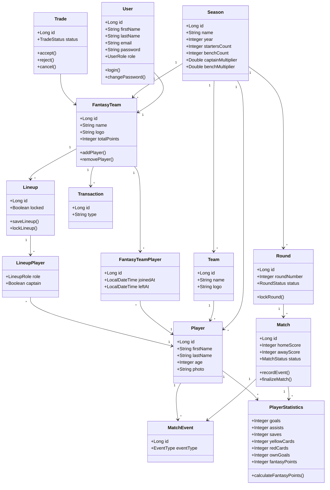

# Class Diagram

## Purpose

This document describes the object-oriented design of the Fantasy Tournament Platform.

The class model serves as the foundation for the Java Spring Boot implementation.

---

# Core Classes

## Tournament Domain

- Season
- Team
- Player
- Round
- Match
- MatchEvent
- PlayerStatistics

## Fantasy Domain

- FantasyTeam
- FantasyTeamPlayer
- Lineup
- LineupPlayer
- Trade
- Transaction

## User Domain

- User

---

# Enumerations

## UserRole

- ADMIN
- MANAGER
- SCOREKEEPER

## MatchStatus

- SCHEDULED
- IN_PROGRESS
- FINALIZED

## RoundStatus

- OPEN
- LOCKED

## TradeStatus

- PENDING
- ACCEPTED
- REJECTED
- CANCELLED

## EventType

- GOAL
- ASSIST
- SAVE
- YELLOW_CARD
- RED_CARD
- OWN_GOAL

## LineupRole

- STARTER
- BENCH

---

# UML Class Diagram

---

# Class Responsibilities

## User

Responsible for authentication and authorization.

---

## Match

Responsible for managing match lifecycle and finalization.

---

## MatchEvent

Represents match actions recorded by the Scorekeeper.

---

## PlayerStatistics

Stores generated statistics and fantasy points.

---

## FantasyTeam

Represents a manager's fantasy team.

---

## Lineup

Represents round-based player selection.

---

## Trade

Represents a trade proposal workflow.

---

## Transaction

Represents historical roster movement.

---

# Business Rules Mapping

- One manager owns one fantasy team per season.
- One player belongs to one fantasy team at a time.
- Lineups lock when a round starts.
- Trades require acceptance.
- Match finalization generates statistics.
- Fantasy points are calculated from player statistics.
- Rankings are derived from fantasy team points.

