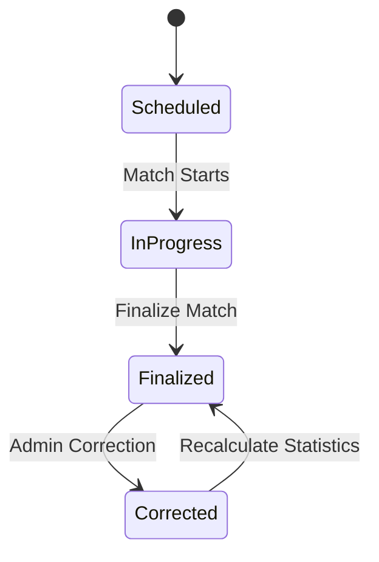
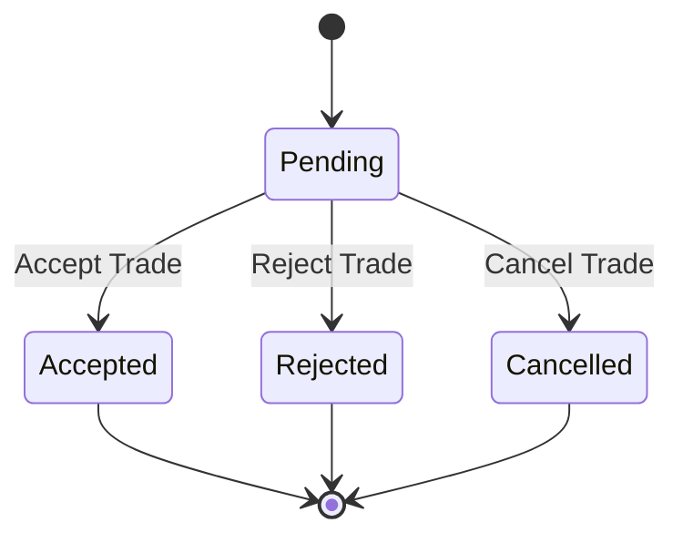
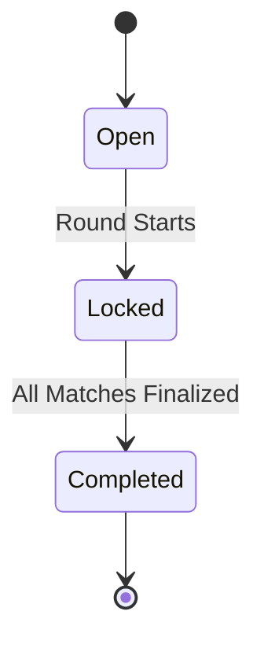
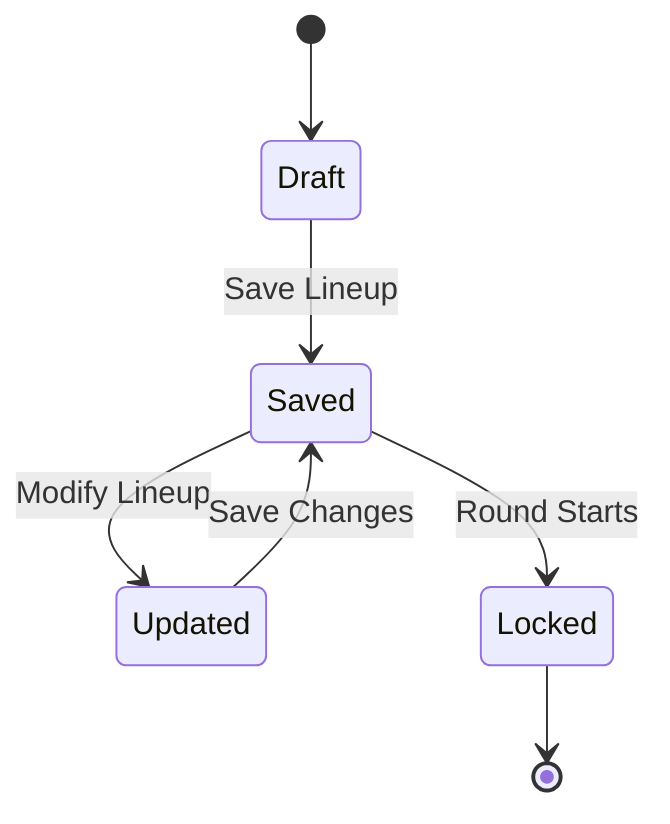

# State Diagrams

## Purpose

This document describes the lifecycle of the most important stateful entities in the Fantasy Tournament Platform.

State diagrams illustrate how entities transition between different states during system execution.

---

# Match State Diagram

## Description

A match progresses through predefined stages from scheduling to completion.

## State Descriptions

| State | Description |
|---------|---------|
| Scheduled | Match is scheduled but not started |
| InProgress | Events are being recorded |
| Finalized | Match completed and locked |
| Corrected | Administrator modified match data |

---

# Trade State Diagram

## Description

A trade request moves through an approval workflow.

## State Descriptions

| State | Description |
|---------|---------|
| Pending | Waiting for manager response |
| Accepted | Trade completed |
| Rejected | Trade denied |
| Cancelled | Trade withdrawn |

---

# Round State Diagram

## Description

A round controls lineups and transfer availability.

## State Descriptions

| State | Description |
|---------|---------|
| Open | Lineups can be edited, transfers allowed |
| Locked | Lineups locked, transfers closed |
| Completed | Round finished |

---

# Lineup State Diagram

## Description

A lineup can be modified until the round begins.

## State Descriptions

| State | Description |
|---------|---------|
| Draft | Initial lineup creation |
| Saved | Valid lineup stored |
| Updated | Lineup edited but not finalized |
| Locked | Lineup cannot be modified |

---

# State Transition Rules

## Match Rules

- Events may only be recorded while a match is InProgress.
- Finalized matches are locked.
- Administrative corrections require recalculation.

---

## Trade Rules

- A trade starts in Pending state.
- Only the receiving manager may accept or reject.
- Accepted trades cannot be modified.

---

## Round Rules

- When a round becomes Locked, lineups are frozen.
- When a round becomes Locked, transfers close.
- Completed rounds are read-only.

---

## Lineup Rules

- A lineup must satisfy roster constraints.
- Exactly one captain must be selected.
- Locked lineups cannot be edited.

- If a manager has not submitted a lineup before round lock, the system automatically copies the most recent valid lineup from the previous round and locks it for the current round.

---

# Business Rule Mapping

| Business Rule | Related Diagram |
|---------------|----------------|
| Finalize Match generates fantasy points | Match |
| Trade requires acceptance | Trade |
| Transfers close when round starts | Round |
| Lineups lock when round starts | Lineup |
| Statistics generated after match completion | Match |

---

# Summary

The Fantasy Tournament Platform contains four major state-driven entities:

- Match
- Trade
- Round
- Lineup

These state diagrams define the operational rules that govern fantasy gameplay and tournament management.
