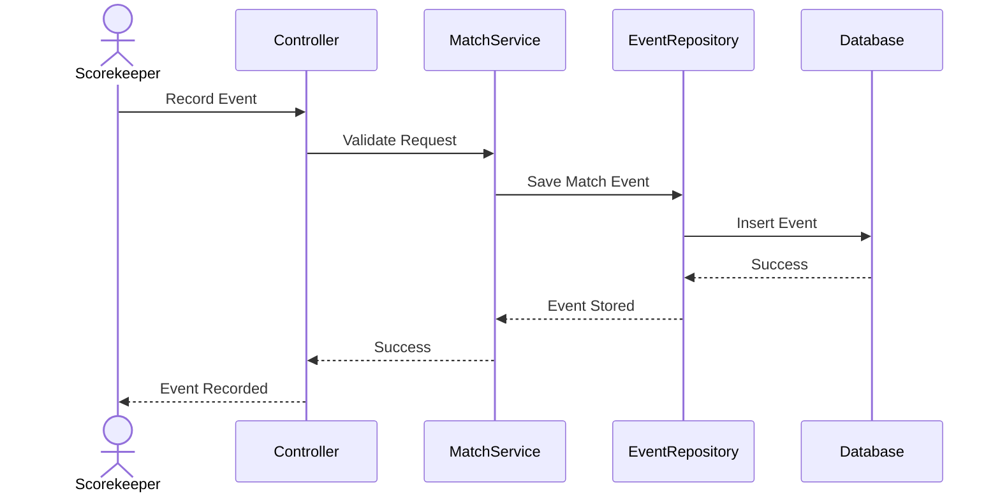
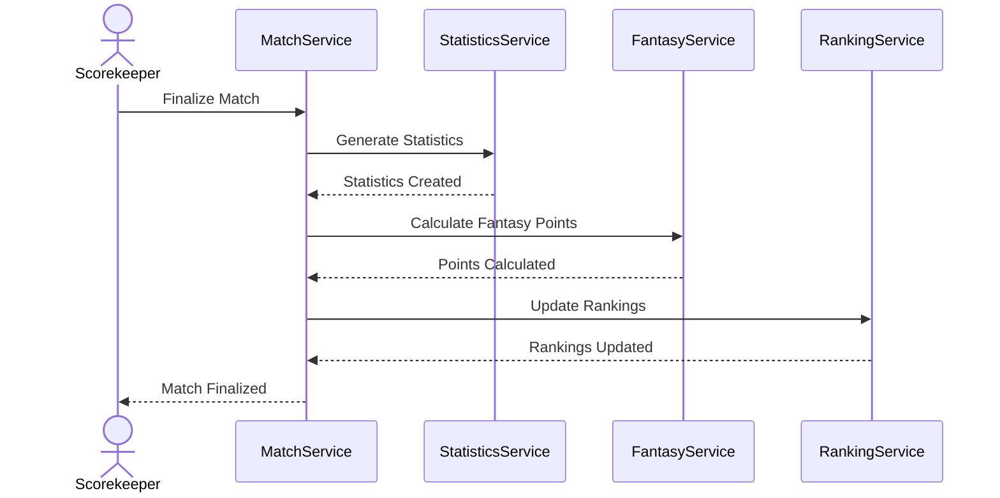
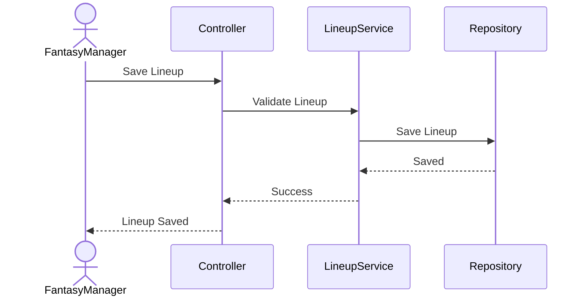
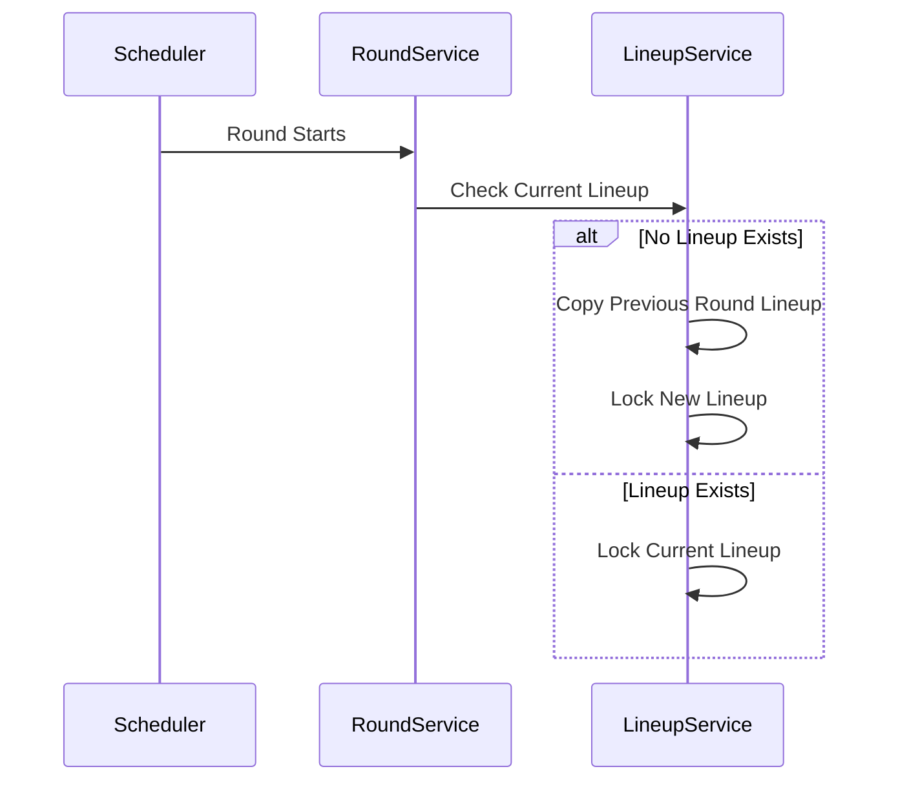
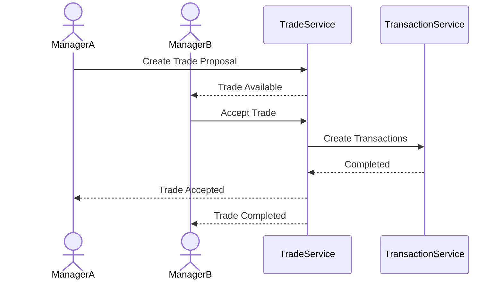
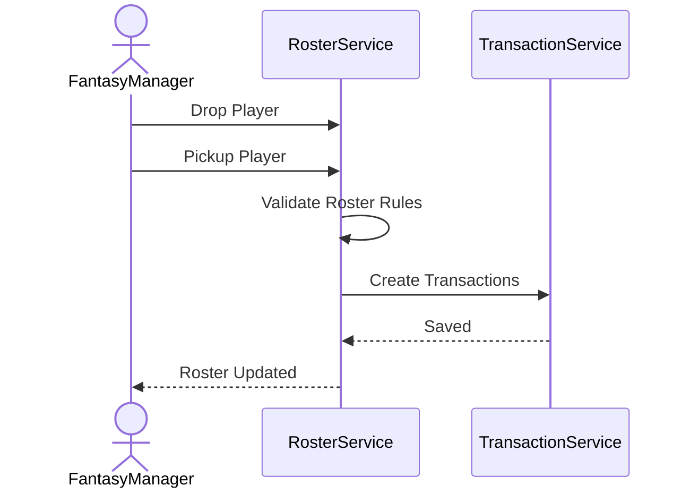

# Sequence Diagrams

## Purpose

This document describes the dynamic interactions between actors, services and system components during the execution of core business processes.

---

# SD-01 Record Match Event

## Description

The Scorekeeper records a match event during an active match.

---

# SD-02 Finalize Match

## Description

The Scorekeeper finalizes a match and triggers all automatic calculations.

---

# SD-03 Save Lineup

## Description

A Fantasy Manager creates or updates a lineup.

---

# SD-04 Auto Copy Previous Lineup

## Description

The system automatically reuses the most recent valid lineup when a manager has not configured a lineup before round lock.

---

# SD-05 Trade Proposal Workflow

## Description

A Fantasy Manager proposes a trade and another manager accepts or rejects it.

---

# SD-06 Pickup / Drop Workflow

## Description

A Fantasy Manager drops a player and acquires a free agent.

---

# Summary

The diagrams cover the most important dynamic workflows of the platform:

- Record Match Event
- Finalize Match
- Save Lineup
- Automatic Lineup Recovery
- Trade Workflow
- Pickup and Drop Workflow

Together they describe the core interactions that drive tournament management and fantasy gameplay.

